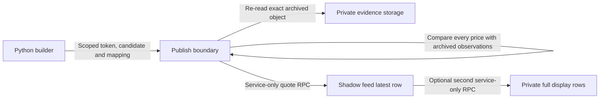

# Shadow app-feed publisher

The private publisher, SQL009/010/013–016 and private bucket are installed, with
all controls disabled. The app publisher is version 8. The completed one-capture
acceptance remains revoked; temporary caller credentials were removed. The
full-row extension is installed but has no active field pin or stored rows.
See `docs/APPLICATION_PRICE_PUBLICATION.md` for the latest verified state.



## What the boundary enforces

- Authenticate a separate `app_publish_` token before reading the body; POST
  only, `application/json` only, no query string, no browser CORS/cookie auth.
  The template disables legacy JWT verification because the handler validates
  its own token; leaving the handler disabled rejects every request.
- The body carries the candidate document, its exact canonical mapping and both
  SHA-256 values. An explicit full-row request also carries its application
  document and SHA-256. Bounded to 2 MiB per document, 1 MiB
  mapping and 8 MiB request body.
- The candidate must be SHADOW_ONLY, `CURRENT_ACQUISITION`, original normalizer
  identities, unpromoted and prediction/valuation ineligible. Replays, the
  legacy ID bridge, promoted authority and arbitrary statuses are refused before
  any storage read.
- The referenced archive object is re-read from `private-market-evidence` at its
  digest path and its bytes, raw capture hash, capture identity, envelope
  contract, provider, completeness, receipt time and frame date must all agree
  with the candidate.
- Every candidate observation must equal the observation in the stored archive
  frame — same identity through the hash-pinned mapping, same exact decimal
  text, same receipt time and row index. No archived observation may be dropped
  and none may be shared between rows. A caller cannot swap one company's price
  onto another or invent a price without also producing an archive that hashes
  to the stored digest.
- Only then is `publish_shadow_market_candidate` called with the service key
  held inside the function. SQL re-validates the pins against
  `app_feed.control`, exact `company`/`format` identity, freshness, ordering,
  capacity and the database guard.

The function exposes no read API, no archive download, no candidate derivation
from raw recipes, no account/portfolio access and no prediction or valuation
path. It does not replace the Python builder: SQL and this boundary do not
re-run the normalization recipe. The builder (`automation/managed/app_feed.py`)
recomputes normalization from raw bytes and the private recipe and refuses any
mismatch; this boundary then proves the submitted document matches the stored
archive frame.

A caller holding the archive write token could store a forged archive and then
publish from it. That is the existing archive trust boundary, not something this
publisher can resolve alone; both tokens must stay private and independently
rotatable.

## Verification

From this package directory, with no network/environment permissions:

```
deno test --no-config --no-remote --no-npm publisher_test.ts
deno check --no-config --no-remote --no-npm index.ts
```

From the repository root:

```
python3 -m unittest discover -s automation/managed/tests -v
python3 tests/integration_app_publisher.py
```

The integration test runs a synthetic Python-built candidate through a loopback
Deno fixture and asserts the exact document hash, plus rejection of an altered
price. Local fixture success is not hosted-service acceptance.

## Full current display rows

`APP_APPLICATION_ROWS_ENABLED` additionally gates full-row requests and defaults
off. The Python publisher's explicit company inputs and private field bindings
produce `app-price-rows/v1`, bound to the exact quote payload SHA and archive.
SQL016 stores the latest full rows privately and exposes authenticated preview v3
under both shadow-feed and projection lease capabilities. All recovered history
and valuation tables retain their contents. The PHP/Flutter reader opts in to
`read_shadow_application_feed`; main screens have not switched.

Quote and application publication are two sequential RPC commits. A second-step
failure returns no successful combined receipt; exact retry is supported. Price
evidence is independently bound by the edge. Additional financial/market fields
are worker-derived and SQL shape-checked, not edge-rederived. All eligibility
flags remain false. New schedules and production execution are inactive.

## Historical installation checklist

The disabled installation and its upgrades are complete. Do not request those
approvals or rerun their SQL again. The checklist below describes the original
setup; active trials and recurring execution remain separate scoped work.

1. Independent review of the handler, token separation, SQL010 and grants.
   Deployment needs explicit authorization and Management/CLI access; project
   API keys do not authorize Management deployment. Source-use approval is
   separate.
2. Install SQL009/SQL010 and create the private bucket as documented in
   `../archive-gateway/README.md`; keep every switch disabled.
3. Copy approved `.ts` files into a private deployment bundle at
   `supabase/functions/private-app-publisher/` and merge `config.toml.example`
   into that bundle's `supabase/config.toml`.
4. Privately generate a high-entropy 64-hex publish token, store only its
   SHA-256 as `APP_PUBLISHER_TOKEN_SHA256`, and give the token only to
   `APP_PUBLISHER_TOKEN`. It must differ from the archive write token. No token
   in argv, shared folders or Git. Leave `APP_PUBLISHER_ENABLED` unset.
5. Configure `APP_PUBLISHER_URL` and `APP_PUBLISHER_TOKEN` for the managed job,
   bound to `archive_project_reference`. CI needs no project/admin key or
   database URI. The publish profile (private mapping plus approved
   mapping/recipe pins) is an encrypted secret, never a repository file.
6. Verify hosted denial, error shapes, read-back, quota, expiry and timings
   before enabling a manual current-session trial. Recurring schedules are a
   separate gate.

This package creates no historical backfill, portfolio valuation, user
assignment or predictions, and never writes the recovered `data`/`latest_prices`
tables.

Primary references checked October 28:

- [Custom function auth](https://supabase.com/docs/guides/functions/auth)
- [Private buckets](https://supabase.com/docs/guides/storage/buckets/fundamentals)
- [Hosted runtime limits](https://supabase.com/docs/guides/functions/limits)
