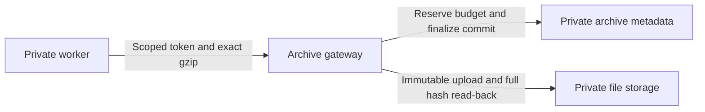

# Private raw-evidence gateway — staged implementation

The previously reviewed gateway is installed **disabled**. The working-tree
company-scoped extension (SQL017) is staged locally and has not been installed.
See `docs/ENRICHMENT_JOB_COORDINATION.md` for this delta and its tests. Existing
v2 archives and slots retain their original meaning. This gateway does not
require database-only SQL007 or move/delete existing recovery records.

The worker supplies only a random `arc_write_` token; its SHA-256 is kept in the
managed function. The project server key stays inside that function, outside CI,
PHP and mobile builds. The external token permits archive submission and boolean
slot lookup. It cannot read/list archives, choose buckets/paths, query tables,
change users, delete/overwrite data or promote authority.



## Integrity and recovery

- Authenticate before reading the body; POST only, no browser CORS/cookie auth.
  The template disables legacy JWT verification because this handler validates
  its own independent token. Leaving the handler disabled rejects every request.
- Accept current `private-acquisition/v2`, UNPROMOTED/prediction-ineligible.
  Reject replay/diagnostic modes; verify aware receipt times, calendar dates, raw
  hashes and namespace-bound capture IDs. Integrity is not source/price authority.
- Bound gzip to 8 MiB, expanded JSON to 24 MiB, each raw response to 4 MiB and
  aggregate raw bodies to 8 MiB. No payloads, native identities or exceptions logged.
- SQL reservations serialize capacity checks, including all existing project
  Storage bytes and outstanding reservations. Unknown sizes fail closed. The
  target bucket must already exist and be private; SQL never edits Storage metadata.
- Use only `sha256/<prefix>/<digest>.json.gz`, with no upsert. Read stored bytes
  back and verify SHA-256/size before finalizing. Exact retries finish interrupted
  uploads without overwriting. Retain all attempts and only the first COMPLETE
  logical-slot commit. Incomplete evidence never completes a slot.
- A missing previously committed object produces an explicit error. Reservations
  never silently expire, free their budget or delete evidence.
- Workers fsync transmission copies into a private local outbox before upload.
  Remove copies only after an exact STORED receipt. Restart retries preserve bytes
  and timestamps. Interrupted partial filesystem writes remain for operator review.

An outbox on an ephemeral runner does **not** survive runner disposal. A verified
private cross-run fallback/recovery archive is required before schedules; no
fallback artifact uploads are enabled. An old capture that never obtained a
reservation can exceed new-admission freshness limits. Recover it explicitly as
history, preserving original times; never retimestamp it to pass admission.

## Capacity

Official Free limits are 500 MB database per project, 1 GB Storage and 500,000
function invocations. Storage billing is organization-wide. SQL009 starts disabled
with upper ceilings of 750,000,000 object bytes and 350,000,000 database bytes.
These are guards, not claims of available quota; review other projects and lower
the allowance as needed. File metadata/receipts still grow PostgreSQL. Measure
actual growth, egress and cloud runtime before activation. Unrelated privileged
Storage writers require coordinated budgeting outside this gateway's reservations.

## Verification and installation gates

From this package directory, with no network/environment permissions:

```
deno test --no-config --no-remote --no-npm gateway_test.ts
deno check --no-config --no-remote --no-npm index.ts
```

Root tests cover rollback-only SQL, concurrent capacity/commits and synthetic
Python-to-Deno HTTP transport. PostgreSQL tests accept only an explicit `/tmp/`
Unix socket. Local/cloud fixture success is not hosted-service acceptance.

Before live installation:

1. Independently review the handler, owner/search-path/grants, capacity and outbox.
   Obtain deployment authorization and Supabase Management/CLI access. Project API
   keys do not authorize Management deployment. Source-use approval is separate.
2. Create private `private-market-evidence` through the Storage API, limiting files
   to 8 MiB/gzip, with no anonymous/app-user policies. Verify denial. Do not insert
   or update Storage catalog rows directly.
3. Install SQL009 in one transaction after checking existing objects/ownership.
   It refuses pre-existing schema/tables. Keep global/provider switches disabled.
4. Copy approved `.ts` files into a private deployment bundle at
   `supabase/functions/private-market-archive/`; merge `config.toml.example` into
   that bundle's `supabase/config.toml`, preserving unrelated settings.
5. Privately generate a high-entropy 64-hex write token. Give its SHA-256 only to
   `APP_ARCHIVE_WRITE_TOKEN_SHA256` in the function, and the token only to the
   encrypted private Actions secret. No token in argv, shared folders or Git.
   Verify managed `SUPABASE_SECRET_KEYS.default`; leave `APP_ARCHIVE_ENABLED` unset.
6. Configure `APP_ARCHIVE_GATEWAY_URL`, `APP_ARCHIVE_WRITE_TOKEN` and recipes bound
   to `archive_project_reference`. CI needs no project/admin key or database URI.
7. Verify hosted auth/error shapes, access denial, read-back, quota/crash recovery,
   cloud timings and the private cross-run fallback. Confirm organization usage.
8. Enable a manual current-session test only after required reviews/authorization.
   Recurring schedules and app/prediction projection remain separate gates.

This package creates no app quotes, dividends/fundamentals, portfolio valuation,
user assignment, historical backfill or predictions.

## Staged subject extension

`APP_ARCHIVE_SUBJECT_ENABLED=true` separately opts in to fundamental-only
`private-acquisition/v3`, with exact `subject_key = symbol:<symbol>`.
It defaults off even when the existing archive switch is on. Per-company
completion is scoped to the current manual trial; unrelated companies and prior
trials cannot satisfy it. Legacy finalization rejects scoped reservations.
Subject completion does not authorize a new source request. The separate positive
admission operation checks current controls, provider, private bucket, scope,
remaining time and quota, plus projection capability/control when requested.
It does not reserve quota against competing callers. No schedule is enabled.

Primary references checked October 28:

- [Free quotas](https://supabase.com/docs/guides/platform/billing-on-supabase)
- [Private buckets](https://supabase.com/docs/guides/storage/buckets/fundamentals)
- [Storage size metadata](https://supabase.com/docs/guides/platform/manage-your-usage/storage-size)
- [S3 keys bypass access rules](https://supabase.com/docs/guides/storage/s3/authentication)
- [Custom function auth](https://supabase.com/docs/guides/functions/auth)
- [Hosted runtime limits](https://supabase.com/docs/guides/functions/limits)
- [Storage error codes](https://supabase.com/docs/guides/storage/debugging/error-codes)
