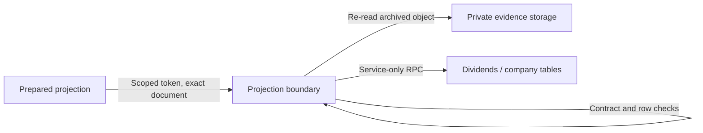

# Projection publication boundary — staged implementation

The previously reviewed function and SQL013 are installed **disabled**. The
working-tree v3 fundamental subject-verification extension is staged locally;
see `docs/ENRICHMENT_JOB_COORDINATION.md`. The older installation guidance below
is historical. No recurring publication is enabled. It is the trusted write path from a prepared
dividend or fundamental projection to the application tables; the archive token
and the shadow-feed publisher cannot do this.



## What the boundary enforces

- A separate `proj_publish_` token, authenticated before reading the body; POST
  only, `application/json` only, no query string. Leaving the function disabled
  rejects every request.
- The body carries only `{document, sha256}`. The hash is recomputed from the exact
  document bytes and SQL recomputes it again.
- The document must be a known projection contract in `PROJECTION_ONLY` mode,
  `CURRENT_ACQUISITION`, unpromoted and prediction/valuation ineligible.
- Dividend rows must carry exact keys, one row per company/year/type, a positive
  amount, valid calendar dates and the same payment-period rules as PHP, Dart and
  the managed builder (source-only confirmation, year agreement, date order).
- Fundamental fields must be exactly the `company` column set with typed values;
  shareholder JSON is parsed and checked.
- The referenced archive is re-read at its digest path from private storage, its
  bytes and capture hashes are verified, and the envelope must be the expected
  kind, provider, execution and completeness; fundamentals must match the
  document's symbol.
- Only then is the service-only RPC called. SQL013 additionally enforces the
  index pin, a STORED archive of that kind, company existence, the dividend rules
  again, the fundamental field contract, and the database capacity guard.

## What it does not do

The boundary does **not** re-run the HTML or financial-series derivation. A caller
holding the token could submit contract-valid values that differ from the evidence.
The index-hash pins, exact company lookups and SQL rules bound the damage, and the
token must stay private and rotatable; comparing the prepared projection with the
source remains part of the reviewed operator flow.

SQL013 applies the same semantics as the retired functions: dividends are upserted
by company/year/type, changed rows update `updated_at`, and rows absent from the
document are never deleted. Fundamentals fill missing fields and replace populated
ones only when the projection's fiscal year is newer; a null never overwrites a
value.

## Verification

From this package directory:

```
deno test --no-config --no-remote --no-npm publisher_test.ts
deno check --no-config --no-remote --no-npm index.ts
```

From the repository root:

```
python3 -m unittest discover -s automation/managed/tests -v
python3 tests/integration_projection_publisher.py
APP_TEST_DATABASE="host=/tmp/... dbname=... user=..." \
  python3 -m unittest tests.test_projection_sql -v
```

The integration test sends a real Python-built projection through a loopback Deno
fixture and asserts rejection of an invalid document. Local fixture success is not
hosted acceptance.

## Installation gates

1. Independent review, explicit deployment authorization and Management/CLI
   access. Source-use approval is separate.
2. Install SQL009 and SQL013 while switches stay disabled; create the private
   bucket as documented in `../archive-gateway/README.md`.
3. Set the provider namespace and both index pins in `app_projection.control`
   from the reviewed private indexes; enable the archive provider and control only
   after hosted denial checks pass.
4. Copy approved `.ts` files into
   `supabase/functions/private-projection-publisher/`, merge
   `config.toml.example`, and generate a token distinct from every other token.
   Give only its SHA-256 to `APP_PROJECTION_TOKEN_SHA256`; leave
   `APP_PROJECTION_ENABLED` unset.
5. Configure `APP_PROJECTION_URL`, `APP_PROJECTION_TOKEN` and
   `APP_PROJECTION_PROJECT_REFERENCE` for the managed job. CI needs no project or
   admin key.
6. Verify hosted auth denial, error shapes, quotas, read-back and timings before
   any manual trial. Recurring schedules remain a separate gate.
