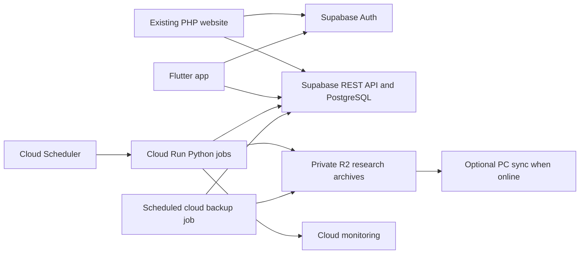

# Appwrite replacement research and migration plan

**Latest direction:** the user accepts fresh accounts/personal data. The
feasibility assessment is complete and **implementation is authorized**. Read
[MIGRATION_HANDOFF.md](MIGRATION_HANDOFF.md) before acting on this older plan.
Its account/hash-transfer and complete-current-export requirements are not hard
prerequisites for the accepted fresh-start approach. Continue building from the
verified pilot; do not ask for implementation authorization again.

Researched 2026-10-22; implementation status updated 2026-10-24. Verified recovery datasets are now in private Supabase staging and typed public market tables, with a tested PHP public REST reader. Production client configuration, subscriptions, and schedules remain unchanged.

The subscription ends in approximately 19 days, around **2026-11-10**. Confirm the exact cutoff in billing before scheduling the final move. The user prefers managed services with minimal maintenance, and their PC must not be required for production availability.

## Live export findings, 2026-10-22

The user-provided Console screenshot confirms an expiring **Education** membership. It says the organization will be disabled when the plan ends if no replacement is selected, and projects will be deleted later; it does not state an exact deletion date. The Console offers Free and Pro as replacement plans. Inspect current usage before choosing either.

Read-only API checks found that database access currently returns HTTP 402, `limit_databases_reads_exceeded`: reads for the current billing cycle are exhausted and the API requests a plan upgrade or budget-cap change. This is a separate obstacle from the upcoming Education expiry. No billing settings or budgets have been changed.

The user's Billing screenshots show an Education monthly cycle of **October 6–November 5, 2026**, with $0 invoices marked Paid and two projects listed in the organization. A read-quota reset around November 6 is an inference from that cycle, not a verified reset timestamp. It would leave approximately four days before the inferred November 10 Education expiry, so the original migration timetable is blocked unless earlier export access is restored. Rounded usage figures are recorded below; exact read counts, per-project contributions, and any adjustable budget cap remain unknown. Do not interpret this as an unpaid-invoice problem or attribute all usage to myInterpreter without the usage breakdown.

The next usage screenshot shows approximately **1.8M/1.8M database reads**, **152.9K/750K writes**, **629.29 MB/150 GB storage**, **2/200K MAU**, **1.8K/3.5M executions**, and **8/1K GB-hours**. The read limit is the exhausted metric. The screenshot's values are rounded and its exact project/organization scope should not be inferred beyond what is visible. Overall Appwrite storage is not a measurement of destination PostgreSQL database size.

Appwrite currently documents Free at 500,000 reads/month, counted per returned row. Existing observed consumption exceeds that allowance by more than threefold, so a Free downgrade cannot preserve the current workload unchanged. Source inspection shows repeated 500-row reads in PHP and Flutter screen loads, plus chart history queries and automation; these are optimization candidates, not proof of which consumer exhausted the quota. The current cleanup implementation filters to the current day and must not be described as scanning all historical rows. [Read accounting](https://appwrite.io/docs/advanced/billing/database-reads-and-writes)

Recommended export-access sequence: request a temporary export allowance or assisted export through Appwrite support first; alternatively prepare the destination using the verified September snapshot and attempt a fresh export immediately after the confirmed reset. A temporary paid bridge requires an explicit checkout review and user decision, including charges for both projects if applicable. A new read-only API key can enable missing user/schema permissions, but cannot itself remove the database quota. Education does not include add-ons, so raising a budget cap alone must not be assumed available or sufficient. [Education FAQ](https://appwrite.io/education)

Live function metadata contains eight functions, **zero cron schedules**, and four recurring intervals: 60, 60, 1,440, and 10,080 minutes. The October 19 scheduling change applies to Education as well as Free; the old five-minute and fifteen-minute cron configuration is no longer evidence of current execution frequency. See the [official schedule change](https://appwrite.io/changelog/entry/2026-10-15-1).

The known private archive bucket contains 1,686 files, with metadata reporting 23,580,325 original bytes. This illustrates the difference between local research-directory size and actual cloud archive size. Bucket enumeration and current schemas/users are not accessible to the existing scoped keys.

The complete older local database export `backup_live_20260919/` still exists. All 11 collection files were validated against its saved row counts and hashes, including private collections: 80,555 documents and approximately 76 MB total. It is a September recovery point, not a current backup.

The ignored `backup_live_20261022_101401/` recovery bundle now contains the eight functions' settings, variables, deployment metadata, and active source archives, plus all 1,686 enumerated files in the known private archive bucket. All 1,713 saved content files passed local byte-count/SHA-256 verification; all storage objects also matched their cloud MD5 signatures, and all gzip streams/source archives were read successfully. Its status remains **PARTIAL_DATABASE_BLOCKED**: current database documents, schema, users, full bucket discovery/settings, and project Console settings are missing. This is an online export, not an atomic snapshot or a tested restoration. Consult its private manifest before relying on it.

## Recommendation

Implementation progress and verified recovery artifacts are recorded in [DATA_RECOVERY_STATUS.md](DATA_RECOVERY_STATUS.md). Public-source rebuilding has been tested successfully for current market data, 2022–2026 dividend calendars, and one company's fundamentals; the locked Appwrite database is no longer the only available starting point.

On October 23, **110,668 records across 12 datasets** were imported into private Supabase staging and every payload was read back and matched against its verified local source. Total measured database size is **125.3 MB**, below the 350 MB pilot target. Schema/table privileges and RLS checks passed. This establishes recovery staging and initial capacity, not production readiness: normalized app tables, authentication, private ownership mapping, client integration, and cloud jobs remain to be implemented and validated.

On October 24, five typed public market tables were populated with **110,662 rows** and every typed value verified. The PHP reader passed eight live REST comparisons against SQL, including history pagination, company and date filters, dividends and quotes. Public-role writes and private staging access were denied. Total database size including staging and app-table indexes was **175.8 MB**. See [SUPABASE_PUBLIC_PILOT.md](SUPABASE_PUBLIC_PILOT.md). Fresh-account Auth, private portfolio tables, atomic trades and opt-in PHP/Flutter integration are now implemented and live-tested; see [SUPABASE_PRIVATE_PORTFOLIO.md](SUPABASE_PRIVATE_PORTFOLIO.md) and [SUPABASE_MOBILE.md](SUPABASE_MOBILE.md). Device/host checks, production email, new admin support, current feeds and managed jobs remain pending. Production clients continue using Appwrite.

Pilot **Supabase Free for application data and authentication, Google Cloud Run Jobs with Cloud Scheduler for Python automation, and Cloudflare R2 Standard for private research archives**. Keep the current PHP website and Flutter UI. This is the best fit identified for this project's languages, private portfolios, and unattended collection; it is an engineering recommendation, not a completed capacity assessment.

**$0 is plausible, but cannot yet be promised.** Plan for a small usage bill rather than designing around an absolute zero-cost guarantee. A provisional **$0–$5/month operating target** is reasonable to test, excluding any new domain, email service, taxes, and unusually large transfer or storage. It is an estimate, not a provider quote or a spending cap. If Supabase needs its paid tier, its $25/month starting price substantially weakens the cost-saving case; decide before migrating.

The main alternate managed backends are **Nhost and Neon**. Include them in the initial pilot decision if Supabase's database headroom is inadequate: Nhost offers an integrated backend with Flutter packages; Neon offers PostgreSQL with managed auth and a Data API. Do not switch platforms solely because a headline storage quota is larger: authentication, PHP access, Flutter integration, permissions, automation, and backup recovery all matter.

## What this repository actually depends on

The initial comparison used source, deployment configuration, and saved artifacts. The subsequent live export findings above add limited API and Console evidence; the usage dashboard and a complete production inventory remain unverified.

| Dependency | Evidence and migration implication |
| --- | --- |
| PHP website | `core/Appwrite.php` uses REST through cURL; `core/auth.php` and login/logout handlers use Appwrite sessions. A replacement REST/auth adapter is needed. Hosting constraints favor HTTP APIs over assuming PostgreSQL drivers or direct database access. |
| Flutter application | `myinterpreter_app/lib/appwrite_client.dart` exposes Appwrite services directly to screens and uses a patched SDK. Replacing the endpoint alone cannot migrate to a different vendor. |
| Public market data | `data`, `latest_prices`, `company`, `format`, and `dividends` need historical data, deterministic identifiers, indexes, and public read access where intended. |
| Private portfolios | `achats`, `ventes`, `portefeuille`, and `benefits` require owner isolation. Preserve actual document permissions and ownership, rather than copying broad collection access. |
| Python automation | Configured price refresh every 15 minutes, order-book collection every 5 minutes, weekly dividends, daily cleanup, and on-demand enrichment. Configured timeouts range up to 900 seconds for cleanup; actual duration is unknown. |
| Other jobs | `daily_pnl` exists in source but is absent from the checked function configuration. Probe and benchmark functions also exist. Inventory live deployments, schedules, and dependencies before deciding which must move. |
| Research storage | Private `orderbook-history` bucket plus collector state, run records, batch manifests, and sync receipts. Collection must continue when the PC is offline. |
| Monitoring and research tools | `watch_errors.py`, sync scripts, data exports, and research automation also access Appwrite. Search outside the main web/mobile paths during implementation. |

The older `CLAUDE.md` says cleanup is absent from function configuration; the current `cloud_function/appwrite.config.json` includes it. Current source/configuration outranks that older note, but configuration still does not prove what is deployed.

### Verified local quantities

All six files in `research/prediction_model/manifest.json` were checked against their recorded row counts, byte counts, and SHA-256 hashes. They match the saved September 19 export:

| Saved collection | Documents |
| --- | ---: |
| `data` | 78,739 |
| `company` | 81 |
| `format` | 81 |
| `dividends` | 350 |
| `latest_prices` | 82 |
| `errors` | 1,167 |
| Total | 80,500 |

These JSON files total **76,084,265 bytes**, approximately 76 MB. Private portfolios were deliberately excluded. This is a historical baseline, not a complete backup or a measurement of PostgreSQL disk usage. The live database has since changed, and indexes, authentication tables, logs, and database overhead must be measured separately.

Separately, selected JSON/JSONL/gzip/Parquet/CSV files under `research/prediction_model/data/` total about **1.33 GB locally**. This includes research and derived files; it does not establish the size of the Appwrite bucket or the bytes that must be migrated. It does establish why raw research archives should have a separate storage budget.

## Alternatives researched

Limits below were checked against official sources on 2026-10-22. Free tiers can change; temporary trial credits are not treated as permanent free hosting. Migration effort is a project-specific assessment.

| Option | Current free offering / material limit | Assessment for myInterpreter |
| --- | --- | --- |
| **Supabase** | 500 MB database, 1 GB file storage, 5 GB egress plus a separate cached allowance, 50,000 monthly active users; two active free projects; inactivity pausing. [Pricing](https://supabase.com/pricing) | **First choice for a pilot.** PostgreSQL suits history, dividends, and transactions. Official Flutter client, REST access for PHP, and row-level permissions. Python automation needs another runtime. |
| **Neon** | Current pricing lists 1 GB database/project, 100 CU-hours/project/month, 5 GB object storage, 5 GB egress, managed authentication, and functions. [Pricing](https://neon.com/pricing) | **Strong PostgreSQL alternative.** More database headroom. Validate PHP and Flutter auth/session integration in a pilot; its documented auth quickstarts emphasize JavaScript frameworks. [Auth docs](https://neon.com/docs/auth/overview) |
| **Nhost** | 1 GB database, 1 GB storage, 5 GB egress, one active free project, one-week inactivity pause; free function execution limited to 10 seconds. [Pricing](https://nhost.io/pricing) | **Strong integrated alternative.** PostgreSQL/auth/GraphQL with official [Flutter packages](https://github.com/nhost/nhost-dart). GraphQL and permission adaptation are required; its free functions do not accommodate the current long Python jobs. |
| **Firebase / Firestore** | 1 GiB stored data, 50,000 reads/day, 20,000 writes/day and deletes/day on the standard free allocation. Cloud Functions require Blaze billing, even where usage is within no-cost allowances. [Pricing](https://firebase.google.com/pricing) | Good Flutter integration, but query/permission rewrites and metered reads are less attractive for this app's historical analysis. Not the preferred overall migration. |
| **Cloudflare Workers + D1 + R2** | D1: 500 MB per free database, 5 GB/account; Workers: 100,000 requests/day and 10 ms CPU/request. [D1 limits](https://developers.cloudflare.com/d1/platform/limits/), [Workers limits](https://developers.cloudflare.com/workers/platform/limits/) | Attractive components, especially R2. A complete replacement requires an auth/API layer and substantial job adaptation. Request count alone does not make the existing scrapers fit Workers Free. |
| **Turso** | Free plan currently lists 5 GB storage, 100 databases, 500 million rows read/month, and 10 million rows written/month. [Pricing](https://turso.tech/pricing) | Generous managed SQL storage, but it does not by itself replace application auth, owner authorization, object storage, and Python scheduling. More custom backend work than Supabase. |
| **Convex** | Free/Starter offering includes auth, crons, and Node.js actions; Free database allowance is 0.5 GB including indexes. [Pricing](https://www.convex.dev/pricing), [Limits](https://docs.convex.dev/production/state/limits) | Useful for reactive applications, but a substantial backend and function rewrite for the existing PHP/Python stack. No demonstrated advantage for this deadline. |
| **Appwrite Cloud Free** | Two-function limit; existing over-limit projects have documented grandfathering caveats. From October 19, cron requires a paid plan; free schedules use intervals of at least 60 minutes. [Function limit](https://appwrite.io/changelog/entry/2026-01-08), [Schedule change](https://appwrite.io/changelog/entry/2026-10-15-1) | **Cannot preserve current automation by simply downgrading.** Retaining its auth/database temporarily while moving jobs is a possible emergency bridge only after verifying all applicable limits. |
| **Self-hosted Appwrite or PocketBase** | Software is free; compute and operations are separate. Appwrite currently documents a minimum of 2 CPU cores, 4 GB RAM, and 2 GB swap. PocketBase warns about compatibility before v1.0. [Appwrite installation](https://appwrite.io/docs/advanced/self-hosting/installation), [PocketBase](https://pocketbase.io/docs/) | Appwrite offers the least application rewrite, but neither option matches the user's maintenance preference. Hosting on a rented server would work with the PC off; it would still require server administration. |
| **Render Free** | Free web services sleep after 15 minutes without traffic; free PostgreSQL expires after 30 days. [Free-service limits](https://render.com/docs/free) | **Reject as a permanent free replacement.** A new short-lived database would repeat the approaching-expiry problem. |

For self-hosting context only: Oracle's current Always Free documentation describes a 2-OCPU/12-GB Arm allocation for Always Free tenancies, subject to capacity and idle-instance reclamation. It is not an operationally managed Appwrite service. [Oracle limits](https://docs.oracle.com/en-us/iaas/Content/FreeTier/freetier_topic-Always_Free_Resources.htm)

A paid server is not automatically a saving: DigitalOcean currently lists its 2-vCPU/4-GiB basic instance at $24/month, before backup and other costs. This is close to a managed backend subscription. [Droplet pricing](https://www.digitalocean.com/pricing/droplets)

## Proposed managed architecture

Production data collection, backup, and alerts run in the cloud. The desktop watcher can remain an optional convenience. No scheduled workflow requires the PC to be online.

### Why automation is separate

Supabase Edge Functions use a TypeScript/Deno-oriented runtime; hosted free workers have a 150-second wall-clock limit and 2 seconds of active CPU per request. They are not a direct home for this repository's Python jobs. [Runtime](https://supabase.com/docs/guides/functions), [Limits](https://supabase.com/docs/guides/functions/limits)

Neon also now offers managed functions and cron triggers, so treating it as only a database would be outdated. Its current functions runtime supports JavaScript/TypeScript, not Python; keeping the existing job language still favors a separate Python runtime. [Neon Functions](https://neon.com/docs/compute/functions/overview)

Cloud Run can execute containerized Python jobs from Cloud Scheduler. Replace Appwrite-specific invocation/context and database/storage calls while retaining the parsing and calculation logic. [Scheduled jobs](https://docs.cloud.google.com/run/docs/execute/jobs-on-schedule)

Google documents 240,000 vCPU-seconds and 450,000 GiB-seconds/month for Cloud Run Jobs, based on us-central1 pricing; jobs have a one-minute minimum billable execution. Regional prices and internet transfer affect the bill. [Cloud Run pricing](https://cloud.google.com/run/pricing)

Three Scheduler jobs per billing account are free; additional jobs cost $0.10/job/month. Keep separate schedules when operationally clearer: saving cents is not worth coupling unrelated critical jobs. [Scheduler pricing](https://cloud.google.com/scheduler/pricing)

### Cost and capacity checks

Use these as pilot acceptance targets, not vendor limits or measured production results:

- **Database:** import a complete current snapshot and measure `pg_database_size` and per-table/index sizes. Target at most 350 MB initially on Supabase Free, leaving roughly 30% headroom; forecast growth for 6–12 months. A JSON export's byte count is not that measurement.
- **API egress:** measure normal web/mobile queries and job traffic; target below 70% of included egress. Use selected columns, pagination, and `latest_prices` for current quotes. Do not repeatedly download all market history.
- **Python compute:** the configured broad windows imply 96 five-minute and 32 fifteen-minute invocations per weekday. With 22 weekdays and separate jobs, that is 2,816 runs/month before maintenance, enrichment, retries, and backups. At one billed minute and one vCPU each, the base is 168,960 vCPU-seconds; at three minutes, 506,880. The latter exceeds the published CPU allowance. Benchmark real runtimes and out-of-session no-op runs before estimating the bill.
- **Archive:** R2 Standard includes 10 GB-month storage, 1 million Class A and 10 million Class B operations/month, with no direct egress charge. Forecast compressed daily growth, the existing backlog, and independent backup copies. [R2 pricing](https://developers.cloudflare.com/r2/pricing/)
- **Ancillary costs:** include container images/builds, secrets, monitoring, outbound traffic, and auth email. Cloud Run requires a billing account; perpetual free usage and trial credits are different. [Google free-tier terms](https://docs.cloud.google.com/free/docs/free-cloud-features)
- **Email:** Supabase's built-in SMTP is restricted and unsuitable for general production delivery. Configure and test an external SMTP service for confirmations and resets; do not disable verification just to avoid setting up mail. [SMTP requirements](https://supabase.com/docs/guides/auth/auth-smtp)

R2 itself requires subscription checkout and bills usage beyond its free allowance. Select the billing arrangement deliberately; it is not a guaranteed hard-capped free bucket. [R2 setup](https://developers.cloudflare.com/r2/get-started/)

GitHub Actions is an alternative for tolerant, infrequent Python tasks, but scheduled runs can be delayed or dropped, and inactive public repositories can have schedules disabled. It is not the default recommendation for time-sensitive order-book capture. Private-repository minutes also share a quota with existing APK builds. [Scheduling behavior](https://docs.github.com/en/actions/reference/workflows-and-actions/events-that-trigger-workflows#schedule), [Billing](https://docs.github.com/en/billing/concepts/product-billing/github-actions)

## Migration sequence within the remaining 19 days

Dates are proposed working targets, assuming implementation begins promptly. This is a multi-day backend migration, with roughly 8–12 focused engineering days plus observation time; access delays or authentication complications can extend it.

### October 22–23: inventory and recoverability

1. Confirm exact subscription expiry, renewal behavior, and current usage. Inventory live databases, collections, indexes, users/auth methods, document permissions, buckets, files, deployments, schedules, webhooks, function environment-variable names, and external consumers.
2. Export **all** current application and private research data, including private portfolio collections, user metadata, permissions, and object bytes. Keep secrets and private records outside Git. Record counts, byte sizes, and hashes; restore a copy to establish that the backup works.
3. Identify production jobs versus manual probes and disabled experiments. Preserve disabled schedules; migration is not authorization to activate experiments.
4. Measure current function durations, memory, failures, object growth, and bandwidth from actual logs/usage. Save aggregate evidence only in the plan.

Exit condition: a complete restore-tested backup and a list of everything that would break if Appwrite stopped.

### October 24–26: prove the managed target

1. In isolated staging, import representative public data into Supabase and exercise PHP HTTP access from the actual hosting environment, Flutter login/read access, and Python writes.
2. Run a short authorized-source fetch from the intended Cloud Run region. Existing research records describe a source rejecting Appwrite cloud requests; changing vendors does not prove reachability. Check status, response schema, latency, and source timestamps without weakening TLS or bypassing access controls.
3. Upload/download a private R2 sample and verify its hash. Benchmark one real collector cycle, price refresh, and cleanup against staging.
4. Measure database disk use and produce a monthly cost forecast with ancillary charges. Check account/region availability, SMTP delivery, and quotas.

**Decision by October 26:** adopt Supabase if it passes. If storage is the blocker, compare Nhost's integrated Flutter/auth path with Neon's REST/auth path using the same sample workload. If no target passes, use a clearly costed temporary bridge rather than force an unsafe migration before the deadline.

### October 27–30: schema, identities, and application integration

1. Create versioned SQL migrations. Keep collection/table names recognizable initially. Preserve legacy document IDs in text columns, original timestamps, explicit market timestamps, null values, and optional JSON payloads where appropriate. Add indexes based on actual queries; test uniqueness before imposing new constraints.
2. Create an explicit old-Appwrite-user-ID to new-auth-UUID mapping. Update all private foreign keys and the admin identity/configuration. Never assume Appwrite IDs are valid UUIDs.
3. Test password-hash export/import compatibility before promising password continuity. If incompatible, use a deliberate password-reset flow with verified ownership and tested SMTP. Expect users to log in again; sessions are not assumed portable.
4. Enable row-level security with owner checks on reads/updates/deletes and ownership checks on inserts/updates. Public data can be publicly readable while writes remain restricted. Research tables and objects remain private. Test as anonymous, user A, user B, and the maintenance role. [RLS documentation](https://supabase.com/docs/guides/database/postgres/row-level-security)
5. Add small data/auth interfaces in PHP, Flutter, and Python; migrate SDK calls behind them. PHP and Flutter portfolio requests must use user credentials. Keep elevated database credentials in trusted jobs only, with least privilege where possible.
6. Make related trade/holdings writes transactional where needed to preserve consistency. Preserve existing calculation behavior and known client differences as explicit baselines; unrelated P&L fixes should not be hidden inside the backend migration.

Expected implementation areas: `core/Appwrite.php`, `core/auth.php`, auth and portfolio handlers/pages, `myinterpreter_app/lib/appwrite_client.dart`, affected screens and dividend helpers, `cloud_function/functions/*`, monitoring/sync tools, ignored environment configuration, and deployment workflows. New SQL and migration scripts should be reproducible and resumable.

### October 31–November 3: complete import and observe jobs

1. Run idempotent, paginated imports, retaining an ID map and audit counts. Include updates and deletions in the final reconciliation design; copying only newly created rows misses corrections.
2. Deploy Python jobs with private authenticated triggers, bounded execution, retry limits, and overlap protection. Replace Appwrite enrichment invocation with explicit orchestration. Preserve Casablanca timezone/session rules, Ramadan overrides, stale-price checks, and official-close safeguards.
3. Observe at least two complete trading sessions. Prefer one source fetch with output mirrored into staging over doubling upstream traffic. When independent fetches are necessary, account for timing differences when comparing prices.
4. Run daily valuation and weekly dividends explicitly in staging if their normal schedule does not occur during observation. Compare per-company/day coverage and representative portfolio results against the same input records.
5. Build the Android release through GitHub Actions and test the upgrade on the phone. Existing APKs hardcode Appwrite: distributing the new version is a cutover prerequisite. Verify unattended backups and alerts with the PC switched off.

### November 4: controlled cutover

1. After market close, stop source job writes and briefly freeze portfolio mutations across web and old mobile clients. Capture a consistent final snapshot/delta, including deletes, and reconcile counts and hashes.
2. Validate ownership, original dates, history coverage, latest-price freshness, balances/quantities, manifests, and object hashes. No new jobs should still write to Appwrite.
3. Switch PHP and the updated Android app, enable target schedules, and smoke-test login, logout, recovery, public screens, portfolio mutations, and cloud monitoring.
4. Keep Appwrite intact for rollback through the remaining overlap. Restrict legacy client writes so transactions cannot silently split between backends.

### November 5–9: observation and contingency buffer

Monitor collection completeness, closing-window data, job failures, login failures, unauthorized-access tests, storage growth, and actual billed usage. Restore the target backup into an isolated environment and compare it. Resolve issues before the approximate November 10 cutoff.

Rollback is more than flipping an endpoint: if the target has accepted trades or new research data, stop writes and reconcile those changes back to the restored source first. Preserve required account/session access and old deployment artifacts throughout the overlap. After the old subscription ends, recovery must rely on verified backups rather than continued paid-project access.

## Acceptance conditions

- All live collections, users, ownership links, source timestamps, and stored objects accounted for; differences documented and explained.
- Both clients complete authentication and portfolio operations; user A cannot read, insert, modify, or delete user B's rows, including attempts to change `user_id`.
- Historical prices, current quotes, dividend states, and representative calculations match the same baseline inputs. Missing data stays missing; projected figures do not become published facts.
- Jobs run unattended for at least two trading sessions, with no unexplained capture gaps or duplicate economic writes after retries.
- Raw research remains private; batch hashes and sync receipts still verify. Retain the existing receipt/hash/grace-based retention safeguards, including protection while the PC is offline. Do not enable a simple age-only deletion rule.
- Database, bandwidth, compute, and storage forecasts fit an explicitly chosen budget with headroom. Alerts alone must not be assumed to enforce a spending cap.
- Cloud backups restore successfully and cover all state needed for recovery; desktop notifications and PC sync are optional.
- New APK is installed by every active user, or an explicit compatibility/retirement plan exists for old clients.

## Decision status

Managed hosting and independence from the user's PC are confirmed preferences. The user created a Supabase project; connection tests and the private recovery staging import passed. Supabase + Cloud Run + R2 remains the pilot architecture, with Nhost and Neon as alternate backends. Initial staging storage has been measured; production growth, egress, user count/auth inventory, runtime benchmarks, email delivery, and the final monthly budget remain unverified. Paid services, production migration, deployment, and subscription cancellation remain subsequent steps.
